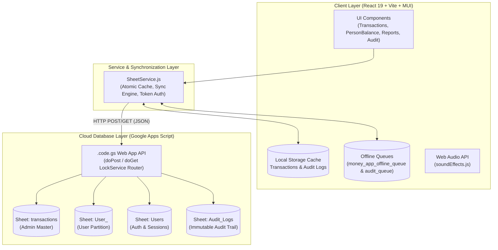

# Ash Flow — Modern Financial & Peer-to-Peer Ledger Portal

**Ash Flow** is a high-performance, offline-first personal finance portal and peer-to-peer ledger application. It enables users to record, track, and manage lending, borrowing, and settlements with real-time balance calculations, automated audit trails, interactive reports, and background synchronization to Google Sheets.

The project runs natively as a responsive web application and is packaged for mobile devices via **Capacitor (Android & iOS)** and desktop via **Electron**.

---

## Table of Contents
1. [System Architecture](#system-architecture)
2. [How Frontend & Backend Work Together](#how-frontend--backend-work-together)
3. [Database & Sheet Schema](#database--sheet-schema)
4. [Core Features & Functionalities](#core-features--functionalities)
   - [Authentication & Multi-Tenant User Isolation](#1-authentication--multi-tenant-user-isolation)
   - [Transaction Management](#2-transaction-management)
   - [Person Balances & Settlement Engine](#3-person-balances--settlement-engine)
   - [Transaction Audit History (Audit Trail)](#4-transaction-audit-history-audit-trail)
   - [Financial Reports & Predictive Analytics](#5-financial-reports--predictive-analytics)
   - [Theme & Sensory Experience](#6-theme--sensory-experience)
5. [Directory Structure](#directory-structure)
6. [Getting Started & Local Setup](#getting-started--local-setup)
7. [Google Apps Script Backend Deployment](#google-apps-script-backend-deployment)
8. [Building for Android (Capacitor) & Desktop (Electron)](#building-for-android-capacitor--desktop-electron)

---

## System Architecture



### Technology Stack
- **Frontend Framework:** React 19, Vite 7
- **UI & Design System:** Material UI (MUI v7), Emotion, Lucide & MUI Icons
- **HTTP Client:** Axios (configured with JSON/Text-plain compatibility for Google Apps Script redirects)
- **Audio Engine:** Custom synthesized Web Audio API (zero external audio file dependencies)
- **Mobile Runtime:** Capacitor 8 (Android & iOS)
- **Desktop Runtime:** Electron 43
- **Backend & Database:** Google Apps Script (`.code.gs`) driving Google Sheets with ACID lock protection

---

## How Frontend & Backend Work Together

Ash Flow uses an **Offline-First, Optimistic UI Architecture**:

1. **Immediate Optimistic UI Updates:**
   Whenever a user creates, updates, or settles a transaction, the app immediately writes the change into component state and `localStorage` partitioned by the active user's username. The UI updates instantly (0ms latency) and plays appropriate audio feedback.

2. **Background Synchronization:**
   The action payload is dispatched via `postRequest()` to the Google Apps Script Web App URL (`VITE_SHEETS_API_URL`).
   - If the device is **online**, Google Apps Script receives the payload, acquires a script lock (`LockService.getScriptLock()`), updates the spreadsheet, and returns a confirmation JSON.
   - If the device is **offline** or the request fails due to poor connectivity, the payload is automatically captured in `money_app_offline_queue_${userId}` or `money_app_audit_queue_${userId}`.

3. **Automatic Reconnection Drain:**
   `SheetService.js` registers browser `online` window event listeners and triggers `syncOfflineQueue()`. Queued transactions and audit logs are transmitted sequentially to Google Sheets with deduplication checks.

4. **User Data Isolation:**
   - Every logged-in user only loads and edits records belonging to their assigned Google Sheet tab (e.g. `User_ashfak`).
   - Local storage keys are namespaced:
     - `money_app_cached_transactions_${userId}`
     - `money_app_audit_records_${userId}`
     - `money_app_offline_queue_${userId}`
     - `money_app_audit_queue_${userId}`
   - Users cannot view, modify, or leak each other's financial records.

---

## Database & Sheet Schema

The Google Spreadsheet acts as the relational database managed automatically by `.code.gs`:

### 1. `transactions` / `User_<username>` Tabs
Stores all primary ledger entries.
| Column | Header | Type | Description |
| :---: | :--- | :--- | :--- |
| **A** | `id` | String / Number | Unique transaction timestamp ID (e.g. `1793189714718`) |
| **B** | `person` | String | Capitalized counterparty name |
| **C** | `amount` | Number | Transaction amount in INR (₹) |
| **D** | `type` | String | `Lent`, `Borrowed`, `Partial Payment`, or `Settled` |
| **E** | `date` | String | Display date in `DD/MM/YYYY` format |
| **F** | `notes` | String | Free-form notes or settlement references `[ref:<id>]` |
| **G** | `method` | String | `Cash`, `GPay`, or `Bank` |

### 2. `Audit_Logs` Tab
An append-only, immutable audit ledger tracking the creation and modification history of all transactions.
| Column | Header | Type | Description |
| :---: | :--- | :--- | :--- |
| **A** | `audit_id` | String | Unique audit event ID (e.g. `audit_1793601258189_...`) |
| **B** | `transaction_id` | String | Original ID of the affected transaction |
| **C** | `action` | String | `CREATE` or `UPDATE` |
| **D** | `previous_values` | JSON String | Snapshot of transaction values before the edit |
| **E** | `updated_values` | JSON String | Snapshot of transaction values after the edit |
| **F** | `timestamp` | String | Exact ISO 8601 modification timestamp |
| **G** | `user_id` | String | Username who created or edited the entry |
| **H** | `reason` | String | Mandatory user reason or automated creation note |

### 3. `Users` Tab
Manages authentication, roles, and authorization.
| Column | Header | Type | Description |
| :---: | :--- | :--- | :--- |
| **A** | `id` | String | User ID |
| **B** | `username` | String | Unique username |
| **C** | `password_hash` | String | SHA-256 password hash |
| **D** | `full_name` | String | Display name |
| **E** | `role` | String | `ADMIN` or `MEMBER` |
| **F** | `status` | String | `APPROVED`, `PENDING`, or `DISABLED` |
| **G** | `created_at` | String | Registration timestamp |
| **H** | `sheet_name` | String | Assigned Google Sheet tab (e.g. `User_ashfak`) |
| **I** | `token` | String | Active session token |
| **J** | `avatar_url` | String | Profile avatar URL or base64 |
| **K** | `admin_view_enabled`| Boolean | Whether user permits admin to view their records |

---

## Core Features & Functionalities

### 1. Authentication & Multi-Tenant User Isolation
- **Role-Based Access Control:**
  - `ADMIN`: Manages member approvals, sheet tab routing, and global settings.
  - `MEMBER`: Accesses their own isolated ledger, person balances, and reports.
- **Session Protection:** SHA-256 hashed password verification and tokenized session cookies stored in `localStorage`.
- **Pending Approval Workflow:** New registrations require approval by the admin before ledger access is granted.

### 2. Transaction Management
- **Add Transactions:** Quick modal for recording `Lent`, `Borrowed`, and `Partial Payment` transactions with person autocomplete, date picker, amount validation, and payment method selector (`Cash`, `GPay / UPI`, `Bank Transfer`).
- **Mobile Card & Desktop Table Views:**
  - Responsive desktop table with color-coded type chips, status badges, and formatted currency.
  - Native mobile cards with zero horizontal scrolling and direct tap-to-history actions.
- **Search & Filtering:** Instant client-side search by person name or note content, plus filter chips for All, Lent, Borrowed, Partial, and Settled.

### 3. Person Balances & Settlement Engine
- **Aggregated Counterparty Balances:** Automatically sums and groups all historical transactions by counterparty name into net position cards (`You Lent ₹...` vs `You Owe ₹...`).
- **Single Transaction Settle:** Users can close an individual transaction by clicking its `Close` button. This creates a linked `Settled` record referencing the original ID (`[ref:1793...]`).
- **Full Account Settlement:** A dedicated `Full Payment to Close` button calculates the exact remaining balance and generates a full settlement entry, marking the account settled and updating balances to ₹0.
- **Interactive Person Modal:** Shows person-specific statistics (Current Net Position, Total Lent, Total Borrowed, total entries) and filtered transaction sub-history.

### 4. Transaction Audit History (Audit Trail)
- **Immutable Log:** Every creation and edit records an immutable entry into `Audit_Logs`. Users cannot delete or alter audit history through the interface.
- **Mandatory Reason on Edit:** When editing an existing transaction, the user must provide a non-empty explanation for the change.
- **Visual Diff Confirmation:** Before saving an edit, a confirmation dialog previews exact field-by-field diffs (`old strikethrough → new green bold`).
- **Dedicated Timeline Viewer:** Click on any transaction or row to open `TransactionAuditModal`. Shows chronologically sorted badges (`CREATED`, `MODIFIED`), modification timestamps, author tags, reasons, and diffs.
- **Pre-Existing Record Transparency:** Pre-existing transactions created before the feature launch date (`30 October 2026`) display an informative note explaining that history tracking commenced on that date.

### 5. Financial Reports & Predictive Analytics
- **Dynamic Timeframes:** Filter analysis across `3M`, `6M`, `1Y`, and `ALL`.
- **Monthly Cash Flow Graph:** Interactive dual-bar chart visualizing money lent vs money borrowed month by month.
- **Payment Method Distribution:** Breakdown of transaction volumes handled through Cash, GPay, and Bank Transfers.
- **Portfolio Health & Insights:**
  - Active debt vs lending ratio.
  - Recovery velocity percentage.
  - Counterparty concentration risk alerts (flags if a single debtor holds >50% or >80% of active capital).
- **Digest Export:** Copy a formatted summary digest to the clipboard with one tap.

### 6. Theme & Sensory Experience
- **Three Theme Modes:**
  - `OLED Black`: True `#000000` dark background optimized for AMOLED screens and battery savings.
  - `Emerald`: Rich dark slate with emerald highlights.
  - `Light`: Crisp, high-contrast light theme.
- **Synthesized Audio Feedback:**
  - Success chime on adding transactions.
  - Cash register / coin drop sound on settlement.
  - Soft alert tone on validation warnings.

---

## Directory Structure

```
Money/
├── .code.gs                     # Google Apps Script backend source code
├── .env                         # Environment variables (API URLs, credentials)
├── capacitor.config.json        # Capacitor native mobile container config
├── package.json                 # Project dependencies and build scripts
├── vite.config.js               # Vite build configuration
├── android/                     # Android native project (generated by Capacitor)
├── dist/                        # Production build output
├── src/
│   ├── main.jsx                 # React root entry point
│   ├── App.jsx                  # Main application container & modal coordinator
│   ├── index.css                # Base CSS, typography, and dark scrollbar rules
│   ├── theme.js                 # MUI theme configurations (OLED, Emerald, Light)
│   ├── ThemeContext.jsx         # Theme state provider
│   ├── assets/
│   │   └── logo.png             # Official Ash Flow application branding
│   ├── Components/
│   │   ├── Navebar.jsx          # Top navigation bar, quick balances, and user menu
│   │   ├── Login.jsx            # Authentication, registration & password reset
│   │   ├── PersonBalance.jsx    # Counterparty cards, person history & settlement
│   │   ├── TrasactionTable.jsx  # Main transaction list (Desktop table + Mobile cards)
│   │   ├── AddTransactionModal.jsx    # Add transaction dialog
│   │   ├── EditTransactionModal.jsx   # Edit transaction dialog with audit reason
│   │   ├── TransactionAuditModal.jsx  # Timeline view of transaction modifications
│   │   ├── ReportsModal.jsx     # Financial analytics, cash flow graph & insights
│   │   ├── AdminUserModal.jsx   # Admin panel for user approval & permission control
│   │   ├── SettingsModal.jsx    # Appearance, sync preferences & profile settings
│   │   ├── CustomDialog.jsx     # Global confirmation & alert dialog
│   │   └── AppInfoModal.jsx     # Version & application credits
│   └── Services/
│       ├── SheetService.js      # Core storage, Google Sheets API, cache & audit engine
│       └── soundEffects.js      # Web Audio API synthesized sound generator
```

---

## Getting Started & Local Setup

### 1. Prerequisites
- **Node.js:** v18.0.0 or higher
- **npm:** v9.0.0 or higher

### 2. Installation
Clone the repository and install dependencies:
```bash
git clone https://github.com/ashfak/ash-flow.git
cd ash-flow
npm install
```

### 3. Environment Variables
Create or verify your `.env` file in the project root:
```env
VITE_SHEETS_API_URL=https://script.google.com/macros/s/<YOUR_DEPLOYMENT_ID>/exec
VITE_APP_USERNAME=ashflow
VITE_APP_PASSWORD=YourAdminPassword
```

### 4. Run Development Server
```bash
npm run dev
```
The application will be accessible at `http://localhost:5173`.

---

## Google Apps Script Backend Deployment

1. Open your target Google Spreadsheet.
2. Navigate to **Extensions > Apps Script**.
3. Replace any existing code with the complete contents of [`.code.gs`](file:///home/ashfak/Money/.code.gs).
4. Click **Deploy > New deployment**.
5. Select type: **Web app**.
6. Set:
   - **Execute as:** `Me (<your-email>)`
   - **Who has access:** `Anyone`
7. Click **Deploy**, authorize permissions, and copy the generated **Web App URL**.
8. Paste this URL into your `.env` file under `VITE_SHEETS_API_URL` and in [`SheetService.js`](file:///home/ashfak/Money/src/Services/SheetService.js#L3-L5).

---

## Building for Android (Capacitor) & Desktop (Electron)

### Web Production Build
```bash
npm run build
```
Builds optimized production assets to the `dist/` directory.

### Syncing to Android (Capacitor)
```bash
npx cap sync android
```
To open the project in Android Studio:
```bash
npx cap open android
```

### Desktop (Electron)
```bash
# Run Electron locally in dev mode
npm run electron

# Package for desktop distribution
npm run pack
```

---

## License & Credits
- **Author:** Ashfak Ahammed
- **Portal:** Ash Flow Finance Portal
- Crafted with care for reliable, offline-first personal financial management.

